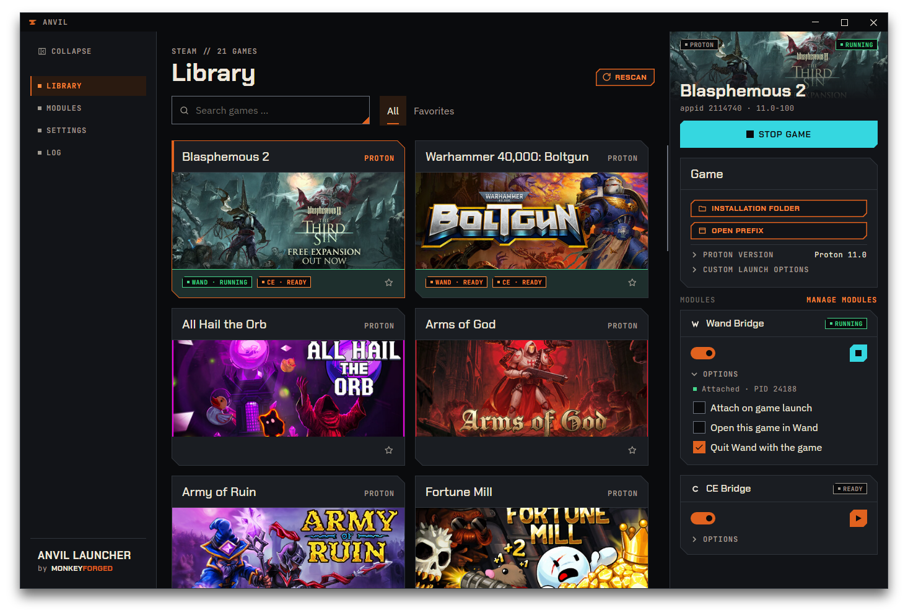

# Anvil Launcher

A modular launcher for modding and patching Steam games on Linux.



## Why Anvil exists

I'm a gamer who recently switched from Windows to Linux. A few conveniences I had come to rely on
simply weren't there, and I didn't want to do without them. So I sat down with Claude and built
Anvil Launcher. Its goal is to turn the fiddly parts of setting up Steam games on Linux into
something comfortable.

Anvil was built for me, so it follows my own setup and my own expectations. I'm sharing it in case
it is useful to you too. Bug reports and feature requests are welcome as issues. I won't be
reviewing pull requests, though — I simply don't have the time for it.

## Status

Version 1.3.1. Everything described below works and is in daily use by its author.

It has been tested on exactly one machine, though: CachyOS, KDE Plasma on Wayland, native
Steam, `proton-cachyos-slr`. If you run something else, you are the first — the parts most
likely to surprise you are Proton detection and the process tree Anvil reads to tell whether
a game is running. Reports are welcome; fixes may take a while.

Releases ship an Arch package and a plain tarball (see [Install](#install)). There is no
AppImage and no Flatpak: a sandbox cannot see the host's process table, which is exactly what
Anvil needs.

## Before you use it

**Do not use Anvil with online, multiplayer or anti-cheat-protected games.** Wand Bridge and
CE Bridge attach third-party tools to a running game. In a game with online play or anti-cheat,
that can get your account banned — permanently. Anvil does not check whether a game is protected;
that judgement is yours, and so is the risk.

**Anvil is not affiliated with, endorsed by or connected to WeMod (now called Wand), Cheat Engine, Valve or Steam.**
These names are trademarks of their respective owners and appear here only to say what Anvil works
with.

Anvil is provided as is, without warranty — see [LICENSE](LICENSE).

## How this was built

Anvil was developed with [Claude Code](https://claude.com/claude-code) — most of the code, tests
and comments were written by an AI model under human direction. The build is warning-free and the
tests pass, but that means the code does what its tests ask, not that the tests ask the right
things. Read it before you trust it, especially where Anvil writes to Steam's configuration.

## Install

Releases live **only here on GitHub** — there is no AUR package and no Flathub entry.
Grab the files from the [latest release](../../releases/latest).

### Arch, CachyOS, EndeavourOS and other Arch-based systems

```bash
sudo pacman -U anvil-launcher-<version>-1-x86_64.pkg.tar.zst
```

This pulls in `dotnet-runtime` if you do not have it, and adds Anvil to your application
menu. To remove it again: `sudo pacman -R anvil-launcher`.

`<version>` is whatever you downloaded — `1.3.1`, say. Tab completion fills it in.

Prefer to build the package yourself? Put the `.tar.gz` from the same release next to
[`packaging/PKGBUILD`](packaging/PKGBUILD) and run `makepkg -si`.

### Everything else

```bash
tar xzf anvil-launcher-<version>-linux-x64.tar.gz
cd anvil-launcher-<version>-linux-x64
./anvil-launcher
```

No installation, no root. You need the .NET 10 runtime on your system — on Debian and
Ubuntu that is `dotnet-runtime-10.0`, on Fedora `dotnet-runtime-10.0`, elsewhere see
[Microsoft's instructions](https://dotnet.microsoft.com/download/dotnet/10.0). The builds
are framework-dependent on purpose: 8 MB to download instead of roughly 90.

## Requirements

- Linux with a desktop environment (developed on KDE Plasma / Wayland)
- The .NET 10 **runtime** to run a release, the **SDK** to build from source —
  on Arch: `pacman -S dotnet-runtime` or `pacman -S dotnet-sdk`
- Steam, installed natively (not the Flatpak)
- Optional: `bubblewrap`, for CE Bridge to fetch Cheat Engine from its vendor. Without it you
  place a Cheat Engine installation yourself; everything else works the same.

## Build and run

```bash
git clone https://github.com/MonkeyForged/anvil-launcher.git
cd anvil-launcher
dotnet run --project src/Anvil.App
```

## What it does

Anvil is a base application plus modules. The base finds, launches and watches your games and
owns the whole interface; everything that changes how a game runs is a module hooking into it.
Nothing is written to Steam until you press `Save`, and every file Anvil writes is copied first.

**[Read the user guide](docs/README.md)** for how to use any of this.

### The base application

| | |
|---|---|
| **Library** | Reads your Steam library: name, artwork, App ID, platform, Proton version and launch options. Search, a favorites filter, and grouping that puts running games first. |
| **Launch and stop** | Starts a game through Steam and stops it again, with a confirmation before anything is killed. A running game is detected from the process tree, with no grace period. |
| **Save & Restart** | Steam only reads its configuration at startup, so Anvil closes Steam, writes, and starts it again. The save bar is the only place this is reported — no dialogs. |
| **Backups** | Every file is copied before it is written, never after. Restore puts a copy back through the same Save & Restart, and is itself backed up. Anvil keeps the 20 most recent copies per file. |
| **A popup that answers "what am I about to lose?"** | Before restoring, Anvil lists every field written since that backup was taken, grouped by game, old value struck through next to the new one. |
| **Log** | One line per event, searchable, filtered by level and by module. The category only appears once something in it has logged. |
| **Settings** | Start with your session, close to tray, and one data location for all module files. |
| **Tray** | `Open` and `Exit`, where the desktop offers a tray at all — Anvil checks and falls back to a normal window if not. |
| **Dependencies** | The one place the runtimes and installers that modules need are listed and fetched. Each component appears once, however many modules want it, and nothing is ever deleted from the storage location on your behalf. |

### Modules

| | |
|---|---|
| **Proton & launch options** | Pick any compatibility tool on your machine, marked by where it came from — `Valve`, `compatibilitytools.d`, or `not installed` for one your library still refers to. `Auto` is not a version: it removes the entry and lets Steam decide. Launch options are written verbatim, and a read-only box shows what Steam will actually receive once the modules have added their share. |
| **Wand Bridge** | Attaches **WeMod** to a game already running under Proton, so both share one environment. Newer versions of WeMod are called Wand; Anvil is tested with WeMod 11.6.0 only. Anvil ships no copy of it, but can fetch WeMod 11.6.0 from the vendor for you (`Get WeMod 11.6.0` in Settings, checked against a known checksum) — or you put a package of your own into its folder. Anvil puts it where the game can reach it and refuses a package that does not contain WeMod. It prepares the prefix with what the program needs, contributes the launch option that makes it reachable, and attaches either on a button press or automatically when the game starts. It can open WeMod directly on the game you are playing, using the public game list WeMod publishes: Anvil fetches it only when attaching, at most once a day, and a switch in Settings keeps it off the network entirely. Detaching stops the program and leaves the game alone. |
| **CE Bridge** | Attaches **Cheat Engine** to a game already running under Proton. It starts inside the game's own container, so the game shows up in its process list as it would on Windows. Anvil can fetch Cheat Engine for you: it downloads the vendor's installer and runs it only inside a `bubblewrap` sandbox, you click through it and decline the offers, and Anvil keeps the program. Or you place an installation yourself. With `Open this game in CE`, Cheat Engine opens with the game already selected, the game rather than its launcher. Detaching asks Cheat Engine to close and ends it after 15 seconds. Wand Bridge and CE Bridge can be attached to the same game at once. |

Modules report their own state, and the base draws it: a chip on the game card, a card in the
detail panel, a group in the right-click menu. No module draws into anyone else's surface.

## How it works

Anvil is a base application plus modules compiled into it: the base reads Steam and draws the whole
interface, the modules report what they can do. Your library comes straight from Steam's files on
disk. Changes wait for `Save`, because Steam only reads its configuration at startup — Anvil closes
Steam, copies every file it is about to touch, writes, and starts Steam again. A game counts as
running while its program is alive in the process tree. To attach WeMod or Cheat Engine, the bridge
modules add one launch option that opens a service inside the game's Proton container, so the tool
runs in the same environment as the game.

## License

[MIT](LICENSE).

The fonts Anvil shows — Chakra Petch, IBM Plex Sans, JetBrains Mono and Silkscreen — come with
the design package MonkeyForged.Design.Avalonia and are licensed separately under the SIL Open
Font License 1.1. Their licence texts ship inside the package
(`packages/MonkeyForged.Design.Avalonia.<version>.nupkg`, folder `licenses/`).
