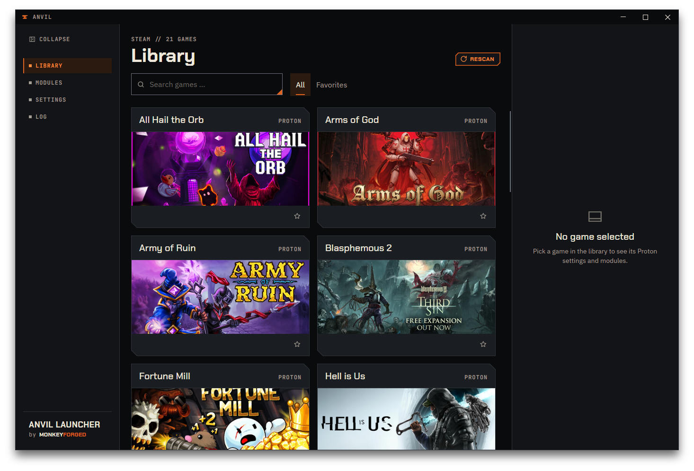
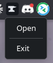

# First run

Start Anvil after installing it. On the first start — and on every **Rescan** after that — it
scans your Steam library and shows what it found as a grid of cards.

## What Anvil reads

For every game, Anvil reads:

- Name, artwork and App ID from Steam's own library data.
- Platform — Windows or Linux, detected from the game's own installed files.
- Proton version, if one is set.
- Your own launch options, if any are set — Anvil calls the field `Custom launch options`.

Games that have never been launched have no Proton version yet. That is expected, not an
error — Steam only records one once a game has actually started under Proton.

Press **Rescan** to read the library again, for example after installing a new game or
reinstalling Steam.

## What Anvil does not touch

Reading your library does not change anything. Nothing is written to Steam's configuration
until you press **Save**, and even then Anvil restarts Steam to apply it: Steam closes, the
files are written, Steam starts again.

## The window

Anvil draws its own window frame. The title bar shows the anvil and `ANVIL` on the left and the
three window buttons on the right: minimize, maximize, close. It behaves like any other window
on your desktop: drag the title bar to move the window, drag an edge to resize it, double-click
the title bar to maximize it and again to restore it.

**Closing** depends on `Minimize to tray` in [Settings](09-settings.md#minimize-to-tray): with
it on, and a tray available, Anvil hides in the tray; otherwise it quits.

When you snap the window to a screen edge, a narrow gap stays between the window and the edge.
That gap is the window's shadow, and it is expected.

Questions Anvil asks before it acts — stopping a game, restoring a backup, opening the Cheat
Engine installer — and the `About` window open as small windows of their own, in the same frame,
centred over the main window. They have only a close button. While one is open, the main window
waits; closing it with the cross or `Escape` is the same as its cancel button.

## The navigation

The column on the left switches between the four pages: `Library`, `Modules`, `Settings` and
`Log`. The page you are on is highlighted in orange.

`Collapse` at the top folds the column down to a narrow strip: the entries shrink to `LIB`,
`MOD`, `SET` and `LOG` — hover one for its full name — and the anvil sits at the bottom. Click
the same place again to unfold it. Anvil remembers which way you left it, also across a restart.

At the bottom of the unfolded column stands `Anvil Launcher` with *by MonkeyForged* below it.
That whole area is a button: it opens [About Anvil](#about-anvil). Folded, the anvil at the
bottom does the same.

## About Anvil

`About` answers three questions in one place: which version you run, where its source lives, and
under which licences Anvil and its parts are published. The navigation's footer stays
highlighted while the window is open.

- **`Version`** shows the version of the Anvil you are running. `Copy version info` puts one
  line on the clipboard — `Anvil Launcher <version> · Avalonia <version> · MonkeyForged Design
  <version> · .NET <version>` — ready to paste into a bug report. It says nothing about your
  machine, your user name or your folders.
- **`Source`** is `github.com/MonkeyForged/anvil-launcher`, where Anvil's code, releases and issues
  live. Click it to open the repository in your browser; you can also select it and copy it.
- **`Licences`** lists Anvil itself — MIT, with `View licence`, which opens the full licence text
  in a second window — and below it every third-party part that ships with Anvil, each with its
  licence: the libraries Anvil is built on, the MonkeyForged design package (© MonkeyForged), and
  the four fonts (SIL Open Font License 1.1). The font licence texts also come with Anvil as files: in the
  tarball in the folder `licenses/`, with the Arch package under
  `/usr/share/licenses/anvil-launcher/`.

At the bottom a sentence makes the line clear: Wand and Cheat Engine are not part of Anvil; you
install them separately, under their own terms. `Close` or the cross shuts the window.

## The tray icon

Anvil adds an icon to the system tray — the anvil as a flat orange shape — with **Open** and
**Exit** in its menu; clicking the icon itself does the same as **Open**.

Whether the icon appears at all depends on your desktop environment — Anvil checks for tray
support on its own, there is nothing to turn on here.

## Where Anvil keeps its own files

Anvil keeps its own files outside your Steam library, at fixed locations:

- **Log:** `~/.local/state/anvil`
- **Backups:** `~/.local/state/anvil/backups`
- **Settings:** `~/.config/anvil/settings.json`

These follow the XDG base directory locations on your system; the paths above are the usual
defaults.

Modules keep their files somewhere else, in a folder you can move: the **data location**, one
subfolder per module. Anvil puts three folders there — `dependencies/` for runtimes and
installers that more than one module might need, `wand_bridge/` for everything Wand Bridge
keeps: the program it attaches, under `wand/`, and its copy of Wand's game list — and
`ce_bridge/` for the Cheat Engine installations CE Bridge attaches. The folders you put files
into are reachable from `Settings` without typing a path; see
[Data location](09-settings.md#data-location).
