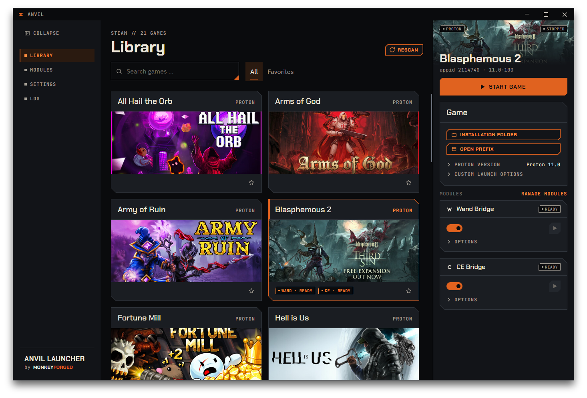
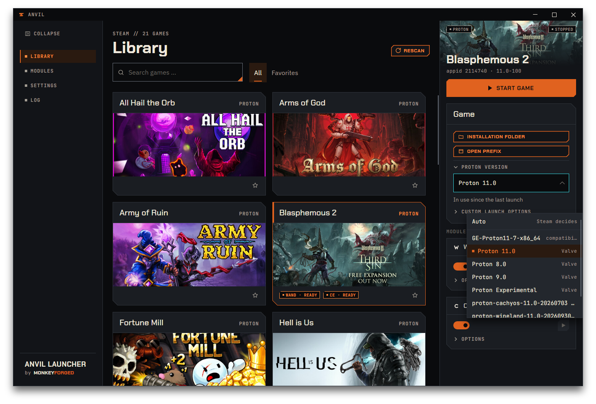
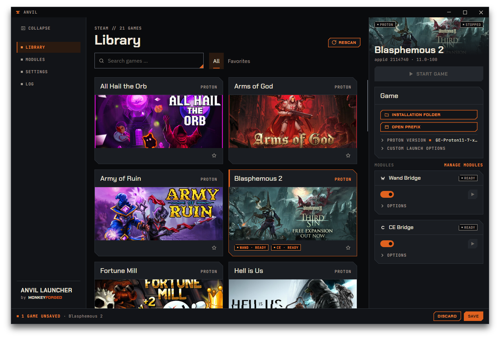
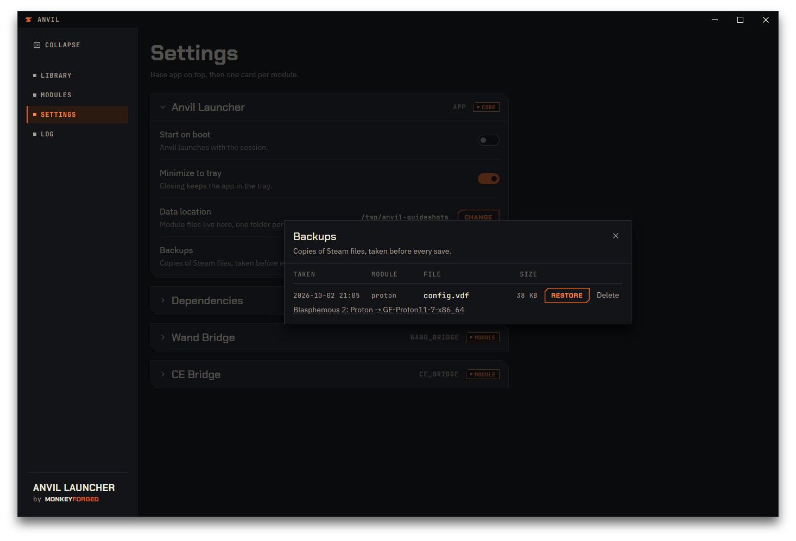

# Your first change

If you read one chapter of this guide, read this one. It walks through a single change from
one end to the other — pick a game, set a Proton version, save it, check what happened — and
then takes it back out again.

## Read this first: saving closes Steam

**Pressing `Save` closes Steam and starts it again. That is intended, and it is not a crash.**
Steam shuts down, Anvil writes to Steam's configuration files, and Steam comes back up on its
own. If you do not know this in advance, Steam vanishing from your screen looks like something
went badly wrong. It is the normal course of events.

The reason is Steam itself. Steam reads its configuration files when it starts, and writes
them back out again while you use it. A change made underneath a running Steam would simply be
overwritten by Steam's own copy. So there is no way to change these settings while Steam is
up: closing it, writing, and starting it again is the only route that sticks, and Anvil does
all three steps for you.

Two things follow from that, and both are worth knowing before you touch anything:

- **You cannot save while a game is running**, because Steam cannot be closed underneath a
  game. Quit the game first; until you do, `Save` stays disabled and the save bar says why.
- **Nothing is written until you press `Save`.** Picking a value only notes a pending change.
  Up to that moment you can walk away and nothing at all has happened to Steam.

## 1. Pick a game

Open `Library` and click a game's card. The card gets an orange frame, and its details appear
in the column on the right; until you pick something, that column says `No game selected`.

The right-hand column is where modules put their settings. The two settings used below come from
**Proton & launch options**; the two bridge modules, [Wand Bridge](06-wand-bridge.md) and
[CE Bridge](07-ce-bridge.md), add a card of their own each further down the column — they need
setting up first and are not part of this walkthrough.

**Most of the column is folded away.** In the `Game` section, `Proton version` and `Custom launch
options` are each one line with an arrow at the left; a bridge card keeps its `Options` the same
way. Click the line to open it, click it again to close it. Every fold starts closed, so the
column stays short.

- **Closed does not mean off.** A closed fold changes nothing about what it holds: a chosen
  version, your own launch options and ticked boxes all stay in force.
- **Each fold remembers whether it is open — for every game at once.** Open `Proton version`
  for one game and it is open for the next game you pick, too. The memory lasts until you quit
  Anvil and is not written anywhere; after the next start every fold is closed again.
- **A closed `Proton version` shows its value** on the right of the line — `Auto` or the name of
  the chosen version — so you can read it without opening it.
- **A small orange square behind the name of a closed fold means a change is hidden inside it**
  and not saved yet. It is the same orange as the save bar, and it does not pulse. Open the fold
  and the square is gone, because you can now see the change itself.

## 2. Choose a Proton version

`Proton version` shows what Steam is configured to use for this game right now — on the right
of its line while the fold is closed. Click the line to open the fold, then click the field
inside it: you get `Auto` at the top, marked `Steam decides`, then the compatibility tools
installed on your system. Each entry says where it came from: `Valve` for the versions that
ship with Steam, `compatibilitytools.d` for ones you installed yourself.

`Auto` is not a version. Choosing it tells Anvil to **remove** this game's entry from Steam's
configuration and leave the choice to Steam — no version is written at all.

Below the field is a quiet line that is easy to skip and worth reading. The field shows what
is **configured**; that line shows what actually **ran**. The two can disagree, and after a
change they will — see step 4.

If the game is a native Linux build, the field inside `Proton version` is locked: there is
nothing to pick, because the game does not run through Proton. The closed line then reads
`not applicable` in dimmed letters. `Custom launch options` stays editable either way.

Pick a different version now, or open `Custom launch options` and type something into it.
Either one is enough for the rest of this chapter. You can close the fold again afterwards; the
square behind its name tells you the change is still waiting.

## 3. Save & Restart

The moment you change a setting, a bar appears along the bottom of the window. That bar is the
only place Anvil reports on saving — there is no dialog and no second location. It names how
many games carry unsaved changes and lists them by name.

While anything is unsaved:

- **`Start game` is disabled** for every game with a pending change, and for all games while a
  save is actually running. `Stop game` is never blocked by this — a game that is already
  running can always be stopped, otherwise you would be stuck, since saving requires that no
  game is running.
- **`Discard` throws the pending changes away** — all of them, not only the selected game's —
  and the settings snap back to what Steam has on disk. The squares go with them. Nothing had been
  written, so there is nothing to undo afterwards.
- **`Save` starts the run.**

Press `Save`. The bar steps through `Closing Steam…`, `Writing…` and `Starting Steam…`, with
`Steam restarts when this is done` beside it; both buttons are disabled until it is over.
Steam disappears and comes back by itself. If Steam was not running when you pressed `Save`,
Anvil does not start it — it only puts back what it closed.

Before Anvil writes to a file, it copies that file first. Those copies are the backups covered
in step 5.

If your change happens to match what is already in Steam's files, nothing is written and no
backup is taken. A save that changes nothing leaves no trace.

## 4. Check what happened

When the run is over the bar disappears. No bar means nothing is pending.

Anvil re-reads your library after every save, so the right-hand column now shows what is
really in Steam's configuration. Your game stays selected.

Open `Proton version` and look at that quiet line under the field again. Straight after a save
it will usually tell you the new version is **not in use yet** and name the one the last launch
actually used. That is correct, and it is not a failed save: the field shows what is
configured, the line shows what ran. They agree again after you next launch the game.

To see what was written, open `Settings`, find the `Backups` row in the `Anvil Launcher` card
and press `Manage`. The list
shows one entry per copied file, newest first, with columns `TAKEN`, `MODULE`, `FILE` and
`SIZE`. `MODULE` names whoever asked for the write — `proton` for the change you just made.

Under a row there is usually a short line saying what the backup was taken for. Where that
line has a dotted underline you can click it: a popup opens and lists, under the heading
`WRITTEN AFTER THIS BACKUP`, each field that changed, with the old value struck through beside
the new one. `Close` shuts the popup.

If the list says `No backups yet`, nothing has been written to Steam on your machine so far.

## 5. Undo it

Same place: `Settings`, then `Manage`, then `Restore` on the entry you want back.

Anvil asks before it does anything, in a small window of its own. The question names the file
and the time the backup was taken, and warns that everything Steam saved into that file since
then will be lost. `Keep current` backs out; so does closing the window with its cross or
`Escape`. `Restore`, filled orange, goes ahead.

Restoring runs through exactly the same Save & Restart as saving did: Steam closes, the file
goes back, Steam starts again. Same mechanism, so the same restriction — `Restore` is disabled
while a game is running.

Two things to understand before you press it:

- **The whole file goes back**, not only the one setting you changed. Anything else Steam
  wrote into that file after the backup was taken is replaced along with it. That is what the
  warning is about.
- **The restore itself is backed up.** Before putting the old file in place, Anvil copies the
  current one, and that copy appears in the list as a fresh entry from the module `launcher`.
  So a restore can be undone the same way.

`Delete` removes a backup straight away without asking, because a backup is only a copy —
deleting one changes nothing about your games or Steam. Anvil keeps the twenty most recent
backups per file name on its own and drops older ones.

The cross in the list's top corner shuts it.

---

That is the whole loop: change, save, check, undo. Everything else Anvil does is a variation
on it — the library, the module fields, the settings and the log are all covered in the
chapters that follow, but the mechanism does not change.
