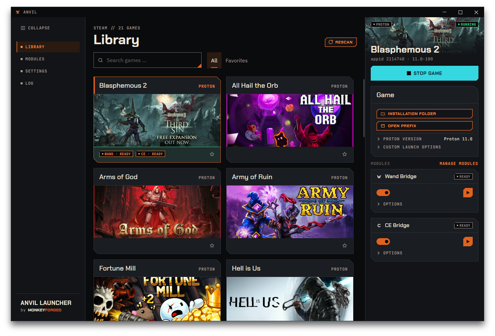
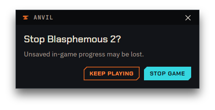
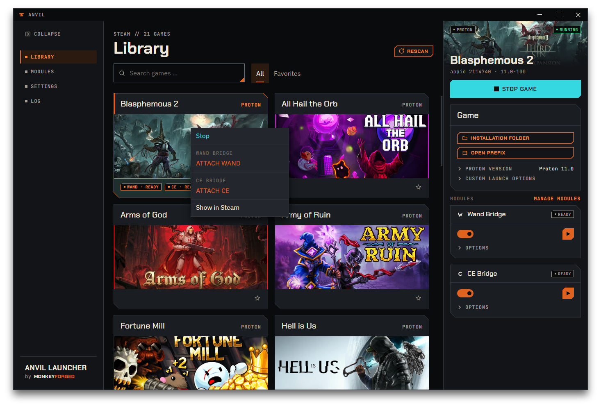

# Library

`Library` is the page you land on after a scan: a grid of cards, one per game, with a
details panel on the right for whichever card you pick.

## The game card

Each card has the game's name at the top, with its platform as one word on the right —
`PROTON`, `NATIVE` or `UNKNOWN`; hover it for what it means: `Runs through Proton`,
`Native Linux build`, or `Platform could not be determined`. The artwork fills the middle, and a
footer below it holds the module chips and a star. The star marks a favorite; click it to
toggle. Unlike the settings covered in
[Your first change](03-first-change.md), the star is written right away — there is no
unsaved state and no `Save` step for it.

Two things on a card are states, and they never get in each other's way:

- **Selected** — the card you picked has an orange frame with a bar along its top edge.
- **Running** — while a game is running, its footer turns into a green band: tinted green, with
  a thin green line along its top. The card does not grow for it, and nothing else on the card
  changes; a screen reader announces the card as `<game>, running`.

A running game that is also selected shows both. When the game ends, the band goes.

Pick a card to fill the details panel on the right. Its header repeats the artwork, with the
platform in a tag at the top left and the state at the top right — `RUNNING` in green or
`STOPPED` in grey — and below it the name and a line reading `appid <id> · <state>`.
`<state>` is the Proton version Steam last used for this game, `native` for a Linux build,
`platform unknown` if Anvil could not tell, or `no proton set` if the game has never run
under Proton at all. That is the same distinction between "configured" and "actually ran"
that [Your first change](03-first-change.md) walks through for the `Proton version` field
below it.

## Module chips

A card can also carry small chips in its footer, one per module that is active for that game
and has something to report. They are small tags in capital letters. In version 1.3.1 two modules
report this way, Wand Bridge and CE Bridge, and their chips read:

| Chip | Colour | What it means |
|---|---|---|
| `Wand · ready`, `CE · ready` | orange | everything the module needs is in place for this game |
| `Wand · auto`, `CE · auto` | orange | the same, and `Attach on game launch` is saved on for this game |
| `Wand · running`, `CE · running` | green | that program is attached to this game right now |

With both modules on for a game, the two chips sit side by side in the order of the modules —
Wand first, then CE — no matter which one you attached first. Detaching one changes only the
wording of its own chip; it keeps its place, and the other chip stays as it was.

`ready` means the module is set up, not that you can attach this second: attaching needs the
game to be running, and until it is, the action button on the module's card stays grey while the
chip still reads `Wand · ready` or `CE · ready`.

**No chip is also an answer.** It means the module is not going to act for this game: it is
switched off, the game cannot use it, or something it needs is still missing. Which of those
it is, the module's card in the details panel says in plain words — see
[Where it does not work](06-wand-bridge.md#where-it-does-not-work).

The chip says `Wand`, while the context menu's heading for the same module says `WAND BRIDGE`.
That is deliberate, and [Wand Bridge](06-wand-bridge.md) opens by explaining it. The same holds
for `CE` and `CE BRIDGE` — see [CE, or CE Bridge?](07-ce-bridge.md#ce-or-ce-bridge).

## Module cards in the details panel

Below the `Game` section, under the label `Modules`, the details panel carries one card per
module that works per game. `Manage modules` on the right of that label takes you to the
[Modules](10-modules-and-log.md) page. Each card has the module's name and a tag in its header;
in the row below sit a switch that turns the module on for **this game only** — hover it for
`Enable module for this game` — and, at the right end of the row, a small square action button
with only a symbol on it (see [Attaching and
detaching](06-wand-bridge.md#attaching-and-detaching)). The global switch is elsewhere, on the
Modules page, and it wins: off there means off everywhere.

The tag is the state, in one word:

| Tag | What the card shows below the header |
|---|---|
| `off` | only the row with the switch. The module is switched off for this game, so there is nothing to operate — the action button is there, grey, so the row does not jump when you switch the module on |
| `ready` | the row, with a short status next to the switch where there is something to say (`Attaching…` while a program is starting), and the module's own settings in a fold named `Options`, closed at first |
| `running` | the same, with the tag in green, the action button now offering the way back out, and `Attached · PID …` as the first line inside `Options` |
| `not possible` | a sentence saying why, the action button grey, and **no `Options` fold** — there is nothing to set. The switch is greyed out and cannot be moved |

The four tags are the same for every module; what goes inside `ready` and `running` is the
module's business. For Wand Bridge, that is [Turning it on for a
game](06-wand-bridge.md#turning-it-on-for-a-game); for CE Bridge, [Turning it on for a
game](07-ce-bridge.md#turning-it-on-for-a-game).

## Search, filter, favorites

`Search games …` matches against the game's name, case-insensitive, as you type. The two
tabs next to it, `All` and `Favorites`, are the only filters — search and filter combine,
so a search narrows whichever tab is active.

Cards are grouped, not just listed: running games first, then favorites, then everything
else. Within a group the order is whatever Anvil read from Steam.

## Starting and stopping a game

The one big button in the details panel reads `Start game` or `Stop game`, depending on whether
the game is running. Starting is orange throughout Anvil and stopping is cyan:
`Start game` is filled orange, `Stop game` filled cyan. A disabled button is grey
whichever it is. The same action, with shorter wording, sits in the card's context menu — see
[The context menu](#the-context-menu) below.

`Start game` is disabled for three distinct reasons that all look the same from the button:

- **This game has an unsaved change pending.** Steam has to be closed to write it, and
  Steam cannot close while a game using it is running.
- **A save is running right now** — for every game, not just the one being changed, since
  Steam is closed for the whole run.
- **A start or stop just began and has not settled yet.** Steam takes a moment to bring a
  game up or down; the button stays locked for that moment so a second click cannot
  overlap it.

`Stop game` ignores the first two reasons — a running game can always be stopped, since
saving requires that nothing is running in the first place. It still locks for the third:
while a stop is actually in progress, a second click is blocked the same way.

Clicking `Stop game` does not stop the game immediately. It asks first, in a small window of
its own in front of Anvil's main window:

> `Unsaved in-game progress may be lost.`
>
> `Keep playing` · `Stop game`

The question reads `Stop <game>?`. Its `Stop game` is filled cyan as well; `Keep playing` is
the outlined one beside it. `Keep playing` closes the window and changes nothing; `Escape` and
the window's own close cross do the same. While the question is open, the main window waits for
the answer. If the game ends by itself while the question is still open — you quit it from
inside the game, say — the window closes on its own; there is nothing left to confirm.

## The context menu

Right-clicking a card opens a menu built in three parts, top to bottom:

1. `Start` or `Stop` — the same action as the button, worded shorter. `Start` is set in orange
   letters, `Stop` in cyan.
2. **One group per module that has something to offer for this game**, each introduced by a
   separating line and the module's name in capitals, in the order of the modules: `WAND BRIDGE`
   with `ATTACH WAND` or `DETACH WAND`, then `CE BRIDGE` with `ATTACH CE` or `DETACH CE`. Each
   group follows its own module's state alone — with Wand attached and CE not, the menu offers
   `DETACH WAND` and `ATTACH CE`. A module with nothing to offer here contributes no group at
   all, not an empty one. The attach entries are set in orange letters like `Start`, the detach
   entries in cyan like `Stop`; this menu is the only place where the two read `ATTACH …`
   and `DETACH …` — on the card, the button is a symbol with a name that appears when you hover
   it.
3. A separating line and `Show in Steam`.

With no module offering anything, the menu is just those two entries. Right-clicking does not
select the card; the menu acts on whichever card you clicked, whether or not it is the one
currently shown on the right.

`Start`/`Stop` is disabled under the same three conditions as the button in the details
panel. A disabled entry stays visible and greyed out rather than disappearing — whatever its
colour would have been — and that applies throughout Anvil, not just here. `Show in Steam` is
never disabled; every game in the library has a page in Steam.

`Show in Steam` opens that game's page in the Steam client and brings its window to the
front. If Steam has no window open at that moment — running with its window closed, say —
Anvil finds nothing to bring forward, and the log records `no steam window to raise (steam
not running yet?)`. The parenthetical guess in that line does not always hold: it also
appears with Steam already running (measured 2026-09-12). Either way it is harmless — the
game's page still opens, and Steam's own window comes forward with it.

## Rescan

`Rescan` reads your Steam library again — what it reads is covered in
[First run](02-first-run.md#what-anvil-reads). Pressing it here keeps your place: if the
game you had selected is still in the library afterwards, it stays selected. An open stop
confirmation closes, since the card behind it no longer exists in the old sense.

A save also triggers this automatically once it finishes — see
[Your first change](03-first-change.md#4-check-what-happened) — so you rarely need to press
`Rescan` for that. Use the button itself after installing or removing a game, or after
reinstalling Steam.
