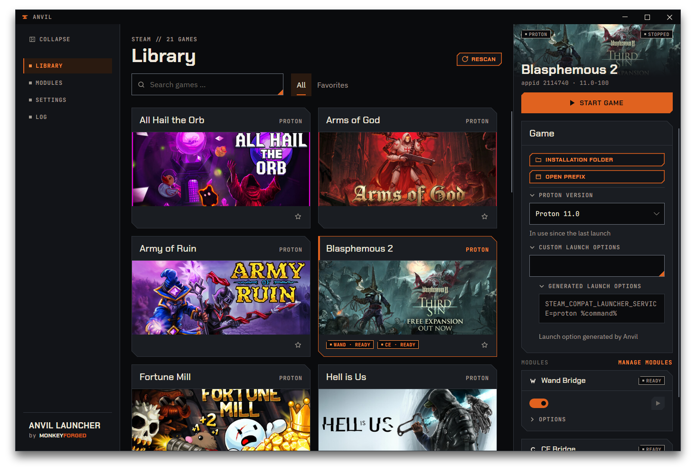

# Proton & launch options

**Proton & launch options** is one of the three modules Anvil ships with — the others are
[Wand Bridge](06-wand-bridge.md) and [CE Bridge](07-ce-bridge.md). It adds two folds to the `Game` section of a game's details
panel: `Proton version` and `Custom launch options`. Both are introduced in
[Your first change](03-first-change.md); this chapter goes into what each one actually does.

The `Game` section also carries two buttons above the folds — `Installation folder` opens
where Steam put the game, `Open prefix` opens its Proton prefix. `Open prefix` is greyed out
for a game that has none: a native Linux build, or one Steam has never run. The two buttons
are always visible; the folds below a separating line start closed.

## The folds

Each fold is one line — an arrow, its name, and sometimes something more on the right. The
whole line is the button: a click opens the fold, the next click closes it. How the folds
behave in general is covered in [Your first change](03-first-change.md#1-pick-a-game); in short,
each fold remembers whether it is open for **all games at once**, until you quit Anvil, and a
closed fold still does what it holds.

- **`Proton version`** shows the chosen version on the right while closed, in the same
  monospaced letters as the field itself: `Auto`, or a name such as `proton-cachyos-slr`.
  After you pick another version the closed line shows the new one at once, before you save.
- **`Custom launch options`** shows nothing on the right. Opened, it holds the field for your
  own launch options and, below it, a second fold, `Generated launch options`
  ([below](#generated-launch-options)), which is closed too.
- **The square.** A small orange square behind the name of a closed fold says that an unsaved change
  of this game lies behind it. For `Proton version` that is a chosen version; for `Custom launch
  options` and `Generated launch options` it is the launch option, whether you typed it or a
  module's switch changed what Anvil generates. `Save` and `Discard` both take the square away.
  Opening and closing the fold does not.

## Choosing a Proton version

Open the `Proton version` fold, and the field inside it lists what is actually on your
machine: the Proton builds Steam itself installed, marked `Valve`, and any compatibility tool
you added yourself, marked `compatibilitytools.d`. The version currently chosen is highlighted
in orange, with a small orange square in front of it. Nothing is invented and nothing hides — a
tool your library once used but that is no longer installed still shows up in the list, marked
`not installed`, so you can see what was set without losing that information.

## What "Auto" means

`Auto` sits at the top of the list, marked `Steam decides`. It is not a version, and
choosing it does not write one. It tells Anvil to **remove** this game's entry from Steam's
compatibility settings entirely, so Steam picks on its own the same way it would for a game
you never touched. There is no way to write `Auto` as a value — the only way this field ever
changes what is on disk is by removing the entry or replacing it with a specific tool.

If the game is a native Linux build or its platform could not be determined, the
field inside `Proton version` is locked — greyed out, nothing to pick, because the choice
would not mean anything. While the fold is closed, its line reads `not applicable` in dimmed
letters instead of a version; the fold itself still opens, and shows the lock and the sentence
that explains it. The rest of the `Game` section stays exactly as normal: the section is
neither hidden nor disabled, and `Custom launch options` below it stays fully editable either
way. This is a fact about the platform Anvil detected for that particular game, not a
missing feature — a native game runs its own binary directly and never goes through Proton.

## Custom launch options

Open the fold and you find a field. It holds the same string Steam itself keeps for this
game — the field you would find in the game's properties inside Steam, in the same place. Anvil
writes whatever you type, verbatim; it does not parse or validate it. `%command%` behaves exactly as it does
in Steam's own dialog, because Steam is what expands it at launch — Anvil is only writing
the string, not interpreting it.

An empty field is a valid value: it means no launch options at all, not "leave whatever was
there."

## Generated launch options

Below the field sits a second fold, `Generated launch options`, closed like the others. Open
it and you see a read-only box with `Launch option generated by Anvil` under it. This is what
Steam will actually receive: your string, plus whatever the enabled modules contribute,
assembled by Anvil.

Two modules contribute something in version 1.3.1 — Wand Bridge and CE Bridge each add
`STEAM_COMPAT_LAUNCHER_SERVICE=proton` for the games you enable them for, which is why the box
can show more than you typed. It is the same option from both, so it stands in the box once,
whichever bridge you switched on first, and stays while either one still needs it. See [What it
needs first](06-wand-bridge.md#what-it-needs-first).

You cannot edit this box, and there is nothing to save in it separately. It is a window onto
the result, kept so that a launch option you did not write does not appear out of nowhere.

Because the box shows what will be written, a square can sit behind `Generated launch options`
as well as behind `Custom launch options`: when a module's switch changes the generated value,
the field you typed in stays as it was, but the result is different, and the change is
waiting for `Save`.

## Why changes need a restart

Both settings go through the same mechanism as every other change Anvil makes to Steam:
nothing is written until you press `Save`, and pressing it closes Steam, writes the files,
and starts Steam again. That sequence, what it means for the `Start game` button meanwhile,
and how to check afterwards what was actually written, are all covered in
[Your first change](03-first-change.md) — it is worth reading in full before you rely on
either one.
