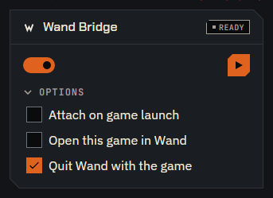
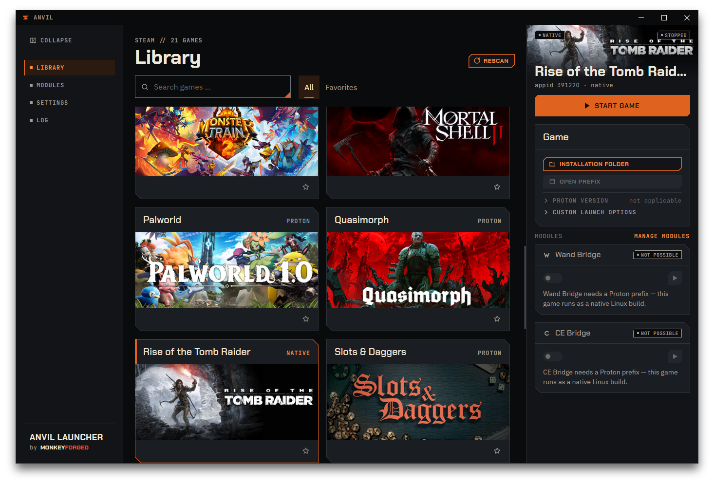

# Wand Bridge

**Wand Bridge** is one of two bridge modules Anvil ships with; the other,
[CE Bridge](07-ce-bridge.md), does the same for Cheat Engine. Wand Bridge attaches **WeMod** to
a game that is already running under Proton, so the two share the same environment and WeMod
can reach the game.

This module does that one thing. It is not a general way to run arbitrary programs alongside a
game: it looks for `WeMod.exe` by name when attaching, knows where WeMod keeps its login, and
turns down a package that does not contain it.

## Wand, or Wand Bridge?

Two names, two different things, and Anvil uses both on purpose:

- **Wand** is what Anvil calls WeMod on its own surfaces — and, as it happens, the name newer
  versions of WeMod carry themselves; Anvil is tested with WeMod 11.6.0 only. It is not part of
  Anvil and not written by whoever wrote Anvil; Anvil can fetch it from the vendor for you, or you
  supply a package yourself. The short name is there because chips and buttons sit on a narrow card, where `Wand · running` fits and
  the full product name does not.
- **Wand Bridge** is the module — the machinery that puts Wand into the right place at the right
  moment and takes it out again.

That is why the chip on a game card reads `Wand · ready` while the context menu's heading for
the same module reads `WAND BRIDGE`. The chip is about the program: can it run here, is it
running. The heading is about the module: this group of entries belongs to Wand Bridge. Once
you know which of the two a label is talking about, the interface stops looking inconsistent.

## What it needs first

Anvil checks three things, in this order, and stops at the first one that is not satisfied.

**1. The program itself.** Until you pick one, the module's card says:

> `The app package is missing — pick it in Settings → Wand Bridge.`

Anvil cannot guess which build you mean — the settings row says as much: `Which build of your
program to attach. Anvil cannot know this — it asks.` There are two ways to give it one. Press
`Get WeMod 11.6.0` in that row, and Anvil downloads that build from the vendor, checks it against
a known checksum and picks it. Or put a package of your own into `wand_bridge/wand/` under your
data location and pick it there; the dropdown lists the files it finds under their own names. See
[Wand Bridge in Settings](09-settings.md#wand-bridge).

**2. What the program needs to run.** Wand needs the .NET Framework 4.8 inside the game's Proton
prefix. Installing it takes more than one file, so the card names whichever one is missing
rather than the component as a whole — do not be surprised to see `4.0` named while the thing
being built is 4.8:

> `The .NET 4.0 installer is missing — get it in Settings → Dependencies.`

`Get missing files` on the [Dependencies](09-settings.md#dependencies) card downloads exactly
what is missing.

**This changes the game's prefix.** Damage to it is not expected, but it cannot be ruled out
entirely, and many games keep their save games in the prefix. Back up your saves before you turn
Wand Bridge on for a game — Anvil's [backups](08-backups.md) cover Steam's configuration files, not
the prefix.

**If you pick the wrong package, Anvil says so rather than failing later.** A package without
`WeMod.exe` in it is turned down on the spot:

> `<file> does not contain WeMod.exe — pick a different package in Settings → Wand Bridge.`

**3. A game that can host it.** The game has to run through Proton and have a prefix Steam has
already created. Where it cannot, the module's card says so in plain words rather than leaving
you to guess why its button is grey — see [Where it does not work](#where-it-does-not-work).

Beyond those three, the module contributes one launch option to every game you enable it for —
`STEAM_COMPAT_LAUNCHER_SERVICE=proton` — which is what makes Steam start the game with a service
Anvil can reach into. Like every other change to Steam, it is written on `Save`, with a backup
taken first; you will see `wand_bridge` in the `MODULE` column afterwards. See
[Backups](08-backups.md).

## Turning it on for a game

Open `Library`, pick a game, and scroll the details panel to the `Wand Bridge` card. The switch
on the card turns the module on for **this game**; the switch on the
[Modules](10-modules-and-log.md) page turns it on or off for all of them, and that one wins.

The card's header holds the module's name and its tag. The row below it holds the switch on the
left and the action button at the right end, a small square with only a symbol on it. The
button is always there; [Attaching and detaching](#attaching-and-detaching) says what it does.
Below that row sits one fold, `Options`, closed at first. It appears only while the module is on
and able to act, and holds three checkboxes — while Wand is attached, with the line
`Attached · PID …` above them:

- **`Attach on game launch`** — attach Wand automatically whenever this game starts, instead of
  pressing the button each time.
- **`Open this game in Wand`** — open Wand directly on this game's page, already attached,
  instead of on its home page. Off by default. See
  [Opening Wand on the game](#opening-wand-on-the-game).
- **`Quit Wand with the game`** — when the game ends, take Wand down with it, rather than leaving
  it running.

**None of them takes effect when you tick it.** All three are ordinary pending changes, like a
Proton version: they are staged until you press `Save`, and `Save` closes and restarts Steam —
the same sequence as any other change, covered in
[Save & Restart](03-first-change.md#3-save--restart).

You can see this in the chip. Tick `Attach on game launch` and the chip keeps saying
`Wand · ready`; it only changes to `Wand · auto` once the change is saved. That is not a delay
in the display — the chip reports what is in force, and until you save, nothing is.

**A closed `Options` fold still counts.** A saved `Attach on game launch` takes effect when the
game starts whether you can see the checkbox or not. If you ticked something and closed the fold
before saving, a small orange square behind `Options` says that a change of this game is waiting
inside; `Save` or `Discard` takes it away. The fold is remembered like every other one: open it
for one game and it is open for the next, until you quit Anvil — Wand's `Options` and CE's are
two separate folds.

**Anvil switches it off again when the prefix loses what Wand needs.** Wand only runs in a prefix
that has the .NET Framework 4.8 installed. If that is gone — the game was reinstalled, you deleted
its prefix, or a Proton update removed it — Anvil turns the switch off the next time it reads your
library, and it checks once more right before every attach rather than attaching Wand to a prefix
it would crash in. Switch it back on and press `Save`: saving installs what Wand needs into the
prefix again, exactly as the first time. See [The Wand Bridge switch turned itself
off](11-troubleshooting.md#the-wand-bridge-switch-turned-itself-off).

## Attaching and detaching

With everything in place, the module's card carries one action button, and the game
card's context menu carries the same action under the heading `WAND BRIDGE`, worded
`ATTACH WAND` and `DETACH WAND` there (see [The context menu](04-library.md#the-context-menu)).

The button has no text; hover it for its name, `Attach Wand` or `Detach Wand`. The name is also
what a screen reader says, and it stands on the grey button too, so you can always tell what
the button means:

| State | Tag | Button | Next to the switch | Chip |
|---|---|---|---|---|
| Ready, game running, not attached | `ready` | play triangle, filled orange — `Attach Wand` | nothing | `Wand · ready` or `Wand · auto` |
| Attaching | `ready` | grey | `Attaching…` with a pulsing orange square | `Wand · ready` or `Wand · auto` |
| Attached | `running`, green | stop square, filled cyan — `Detach Wand` | nothing | `Wand · running` |

Orange starts and cyan ends, here as on `Start game` and `Stop game`.

**`Attaching…` is never hidden**: it stands next to the switch whether `Options` is open or
closed. **The process ID is in `Options`**: once Wand is attached, the fold's first line reads
`Attached · PID …` with a steady green square, above the three checkboxes. With the fold closed
the green tag already says that Wand is attached, so the card shows nothing more.

**The button is grey whenever it cannot act**, and it is still there: the game is not running,
the module is off for this game, the card says `not possible`, or Anvil is busy attaching or
detaching. A grey button shows the symbol of what it would do — the stop square while something
is attached or on its way out, the play triangle otherwise.

**The game has to be running.** Attaching means starting Wand inside the container the game is
already running in; with no game, there is nothing to attach to. With the game stopped, the
card still says the module is ready — that is about the setup, not about this moment — but the
button is grey until you start the game.

**Attaching can take a while** — up to two minutes, while Wand starts inside the game's
container. During that time `Attaching…` stands next to the switch and the button stays
grey, so a second click cannot start a second attempt. When Wand is up, `Attaching…` goes away,
the tag turns to a green `running`, the button becomes the cyan stop square, and
`Attached · PID …` appears inside `Options`. Detaching puts the play triangle back, the tag
returns to `ready`, and the line in `Options` goes away.

**Detaching stops Wand, not the game.** It ends the processes Anvil started and leaves everything
else alone — including a second game you have Wand attached to at the same time. The game keeps
running and is not restarted.

**Wand and CE can share a game.** With CE Bridge on for the same game, both can be attached at
once, and detaching one leaves the other running. See [Wand and CE on the same
game](07-ce-bridge.md#wand-and-ce-on-the-same-game).

**Wand starts without Steam's overlay.** Since version 1.2.0, Anvil starts Wand with Steam's
overlay switched off for Wand. The game's own overlay stays as it was.

**Your Wand login is carried across.** The container a game runs in is not where Wand normally
keeps its files, so Anvil copies your login into it before attaching and copies it back out
afterwards. You should not have to log in again on every launch. If you do, see
[Wand asks me to log in again](11-troubleshooting.md#wand-asks-me-to-log-in-again).

## Opening Wand on the game

With `Open this game in Wand` ticked and saved, Wand opens straight onto this game's page and is
already attached — you do not have to pick the game in Wand yourself. This applies to the
attach button on the card, the same action in the game card's context menu, and an attach triggered by
`Attach on game launch` alike.

To know which game in Wand corresponds to which Steam game, Anvil uses a public list of games
that Wand itself publishes; Anvil keeps a copy of it under `wand_bridge/catalog/` in your
[data location](09-settings.md#data-location).

Anvil goes online for that list only when attaching a game with the checkbox saved on, only when
its copy is missing or more than a day old, and only when `Look up games online` in
[Settings](09-settings.md#wand-bridge) is on. Never at startup, never in the background, and
never at all with the checkbox off.

Without a network, without a copy yet, or without an entry for this game, Wand opens on its home
page exactly as before — Anvil shows no message for this, but the
[Log](10-modules-and-log.md#the-log) names it (`no mapping`) — see
[Wand opens on its home page](11-troubleshooting.md#wand-opens-on-its-home-page-not-on-the-game).
The very first time you attach with
the checkbox on, there may be nothing to look up from yet, and Anvil waits up to three seconds for
the download to finish before giving up and opening the home page instead.

**Limit:** if Wand is already running, Anvil does not check whether it jumps to the newly attached
game — detach it first.

See [Wand Bridge in Settings](09-settings.md#wand-bridge) for the switch that allows Anvil to go
online for the list at all.

## Where it does not work

When the module cannot act for a game, its card says `not possible`, greys out the switch, and
gives the reason in a sentence below it — without opening anything. The action button
stays, grey, and there is no `Options` fold, because there is nothing to set.

There are four such sentences, and each means something different:

> `Wand Bridge needs a Proton prefix — this game runs as a native Linux build.`

There is no Proton prefix to work with, because the game does not use one. Nothing to fix.

> `Wand Bridge needs a Proton prefix — the platform of this game could not be determined.`

Anvil could not tell from the installed files whether this is a Windows or a Linux build, and it
will not guess.

> `Wand Bridge needs a Proton prefix — start the game once so Steam creates it.`

Steam builds a game's prefix the first time it runs the game, not when it installs it. Start the
game once, quit it, then press `Rescan`.

> `This game was moved back to an older Proton version. Anvil cannot undo that — switch back in
> Steam, or let Steam rebuild the prefix.`

This one is different from the other three: it names no module, because it is about the prefix
rather than about Wand Bridge. Below it Anvil prints which Proton version the prefix was prepared
for and which one is set now, so `switch back in Steam` has a target.

## What version 1.3.1 does not do

**A failed attach does not show on the card.** If attaching does not work — the game exits
while Anvil is still waiting, the container refuses, the program does not come up — the card
does not say so. `Attaching…` goes away, and the button turns back into the play
triangle, ready for another try.

The [Log](10-modules-and-log.md#the-log) is the only place the failure is recorded. This is a
known gap, not something you did wrong; [Attaching Wand or CE appears to do
nothing](11-troubleshooting.md#attaching-wand-or-ce-appears-to-do-nothing) says which lines
to look for.
