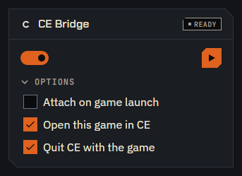

# CE Bridge

**CE Bridge** attaches **Cheat Engine** to a game that is already running under Proton. It starts
Cheat Engine inside the game's own environment, the container Steam runs the game in, so
Cheat Engine finds the game in its process list just as it would on Windows.

It is the second bridge in Anvil, built the same way as [Wand Bridge](06-wand-bridge.md):
the same switch per game, the same kind of button, chip and `Options` fold. What differs is how the
program gets onto your machine, and what happens when you detach it.

This chapter covers Anvil's part. It assumes you know Cheat Engine itself from Windows.

## CE, or CE Bridge?

Two names, the same split as with Wand:

- **CE** is what Anvil calls Cheat Engine on its own surfaces, the chip on a game card
  (`CE · running`) and the button's name (`Attach CE`). Cheat Engine is not part of Anvil and not
  written by whoever wrote Anvil.
- **CE Bridge** is the module, the part of Anvil that brings Cheat Engine into the game's
  container and takes it out again. Its name heads the card in `Settings`, the row on the
  `Modules` page, the card in the details panel and its group in the context menu (`CE BRIDGE`).

The chip talks about the program, the heading talks about the module.
[Wand, or Wand Bridge?](06-wand-bridge.md#wand-or-wand-bridge) explains the same split at length.

## What it needs first

One thing: **a complete Cheat Engine installation, chosen in `Settings` → `CE Bridge`.** CE Bridge
is on by default on the `Modules` page, but its tag says `not ready` until that choice is made, and the details panel shows no CE Bridge card in the meantime. The `Modules` page
gives one of two reasons:

> `CE is not installed yet — get it in Settings → CE Bridge.`

Nothing usable lies in the `ce_bridge/` folder yet. Either let Anvil get Cheat Engine for you
([Getting Cheat Engine](#getting-cheat-engine)), or put an installation there yourself
([Placing an installation yourself](#placing-an-installation-yourself)).

> `No CE version selected — pick one in Settings → CE Bridge.`

At least one complete installation is there, but none is chosen, or the one you chose has gone
since. Anvil never picks one for you, not even when there is only one. Choose it in the
`CE version` row. See [CE Bridge in Settings](09-settings.md#ce-bridge).

**What it does not need:** no .NET, no runtime and nothing else inside the game's prefix. Cheat
Engine runs as it is, so there is no preparation step when you save, unlike Wand. The only change
CE Bridge makes to Steam is the launch option covered under
[Turning it on for a game](#turning-it-on-for-a-game).

## Getting Cheat Engine

With nothing in `ce_bridge/`, the `CE version` row offers `Get CE 7.7`, with this line below it:

> `Anvil downloads the installer from the vendor. You click through it; Anvil keeps the program.`

The vendor only hands out the Windows version as a web installer, and that installer offers
you other software along the way. So before anything happens, Anvil asks:

> **Open the Cheat Engine installer?**
>
> The next window is the vendor's installer, not Anvil. It will offer you other software. Choose
> **Decline** on every offer — none of it works on Linux.
>
> `Cancel` · `Open installer`

`Cancel` does nothing at all. `Open installer` starts the run.

**Decline every offer.** None of them works on Linux, and Anvil clicks nothing in the
installer for you: the only way to say no is your own click.

What Anvil does, step by step, and what the row shows meanwhile:

| Step | What Anvil does | The row shows |
|---|---|---|
| 1 | Downloads the installer from the vendor's address | `fetching`, a bar of segments that fills in orange with the percentage above it, and `Cancel` |
| 2 | Opens it in a sandbox (`bubblewrap`), with a throwaway prefix of its own. You click through it. Afterwards Anvil keeps only the program folder and deletes the throwaway prefix with everything else in it | `installer open`, `Cancel`, and *Finish the installer in its own window. Choose **Decline** on every offer.* |
| 3 | Checks every file it kept against the list of the standard version 7.7, by name and content | `checking`, *Checking that the installed program is complete.* |
| 4 | Places it as `ce_bridge/7.7/` and selects it | `7.7`, `ready to attach` |

If the installer starts Cheat Engine at the end, close that window too: the row stays on
`installer open` until every program the installer started has ended. Running the installer
needs a Proton version installed in Steam, because Anvil runs it with Proton's Wine.

`Cancel` while the installer is open ends the sandbox and everything running in it; nothing is
kept and no message appears. You can leave the `Settings` page during the run without
interrupting it. Quitting Anvil ends it, and the next `Get CE 7.7` clears what was left.

**The sandbox:** the installer sees neither your home folder nor your drives and can write only
into its throwaway prefix. If you accept an offer by mistake, whatever it installs stays in that
prefix and is deleted with it. **What it does over the network while the installer runs, Anvil
does not prevent** — the installer needs the network, so the sandbox leaves it open.

If anything goes wrong, the row shows a red sentence and `Get CE 7.7` comes back. Nothing is
kept, and Anvil never overwrites or deletes a version already in `ce_bridge/`. What each red
sentence means: [Getting CE failed](11-troubleshooting.md#getting-ce-failed).

## Placing an installation yourself

You can put a Cheat Engine installation into `ce_bridge/` yourself instead. The second row of the
card says so: `Or put a complete installation into ce_bridge/.` Its `Open folder` button opens
the folder; it lies in your data location, see
[Where Anvil keeps its own files](02-first-run.md#where-anvil-keeps-its-own-files).

Reasons to do it: you have the version without offers (from the vendor's Patreon, say), you want
a different version than 7.7, or you have no `bubblewrap` (see
[Without bubblewrap](#without-bubblewrap)).

- **A folder or a `.zip`**, directly inside `ce_bridge/`. It shows up under its own name, a zip
  without `.zip`. The program may sit one folder deeper, as in a zip that holds a
  `Cheat Engine/` folder.
- **Another version is fine.** Anvil checks only that the installation is complete:
  `cheatengine-x86_64.exe` is there, and none of the three extra files of the deliberately
  crippled build the vendor hands out when its web installer is bypassed. Anvil does not check
  the version, nor any files you added.
- **Incomplete entries do not appear for selection.** The [Log](10-modules-and-log.md#the-log)
  says for each one why it was left out.
- A folder and a zip of the same name: the folder counts, the zip is skipped. A folder named
  `app` and names starting with a dot are ignored.

Anvil has no watcher on the folder. It reads it again whenever the `Settings` page is shown or
the `CE application` list is opened. Then pick your installation in `CE version`, and the row says
`ready to attach`.

**Anvil never writes into what you placed.** On the first attach it copies the chosen version
into `ce_bridge/app/`, and from then on Cheat Engine starts from that copy. The copy is made once
per name. If you later put something different into `ce_bridge/` under the same name, delete its
copy in `ce_bridge/app/` so the next attach copies afresh.

## Without bubblewrap

Anvil runs the vendor's installer only inside `bubblewrap`. Without it, `Get CE 7.7` stays greyed
out, and the row says why instead:

> `Getting CE needs bubblewrap. Install it, or put a complete installation into ce_bridge/.`

Install `bubblewrap` with your distribution's package manager, then switch to another page and
back to `Settings`: Anvil looks for it every time the page is shown. Or take the other way the
sentence names, [Placing an installation yourself](#placing-an-installation-yourself), which works
without `bubblewrap`. See also
[Get CE 7.7 is greyed out](11-troubleshooting.md#get-ce-77-is-greyed-out).

## Turning it on for a game

Open `Library`, pick a game, and find the `CE Bridge` card in the details panel, below
`Wand Bridge`. The switch on the card (`Enable module for this game`) turns the module on for
**this game**; the switch on the [Modules](10-modules-and-log.md) page turns it on or off for all
of them, and that one wins.

The card is built like Wand's: the header holds the name and the tag, the row below it the
switch and the action button, and below that sits the closed fold `Options` with three
checkboxes. The fold appears
while the module is on and able to act. Its open state is its own — separate from Wand's
`Options` — and, like every fold, shared by all games until you quit Anvil; a small orange square
behind a closed `Options` says that a change of this game is waiting inside. See [Turning it on
for a game](06-wand-bridge.md#turning-it-on-for-a-game) at Wand Bridge for both. Open the fold
and you find:

- **`Attach on game launch`** — attach Cheat Engine automatically whenever this game starts.
  **Off** by default.
- **`Open this game in CE`** — Cheat Engine opens with the game's process already selected. **On**
  by default, unlike its counterpart at Wand. See [Opening the game in CE](#opening-the-game-in-ce).
- **`Quit CE with the game`** — when the game ends, Anvil detaches Cheat Engine as well. **On** by
  default.

Turning CE Bridge on for a game adds the launch option `STEAM_COMPAT_LAUNCHER_SERVICE=proton`,
the same one Wand Bridge adds, which lets Anvil start a program inside the game's container.

**Nothing takes effect when you tick it.** The switch and all three checkboxes are pending
changes, staged until you press `Save`, which closes and restarts Steam, see
[Save & Restart](03-first-change.md#3-save--restart). A saved `Attach on game launch` works with
the fold closed, too. The chip shows it: tick
`Attach on game launch` and it still reads `CE · ready`; only after saving does it read
`CE · auto`.

## Attaching and detaching

The card carries one action button, and the game card's context menu carries the same
action under the heading `CE BRIDGE`, worded `ATTACH CE` and `DETACH CE` there. It works as at
Wand Bridge — see [Attaching and detaching](06-wand-bridge.md#attaching-and-detaching) for the
full table: a play triangle filled orange attaches, a stop square filled cyan detaches,
the button is grey whenever it cannot act, while attaching `Attaching…` stands next to the
switch, and once attached `Attached · PID …` is the first line inside `Options`. Hover the
button for its name:

| State | Tag | Button | Next to the switch | Chip |
|---|---|---|---|---|
| Ready, game running, not attached | `ready` | play triangle, orange — `Attach CE` | nothing | `CE · ready` or `CE · auto` |
| Attaching | `ready` | grey | `Attaching…` | `CE · ready` or `CE · auto` |
| Attached | `running`, green | stop square, cyan — `Detach CE` | nothing | `CE · running` |

**The game has to be running.** Until it is, the card still says `ready`, which describes the setup,
but the button stays grey. When you attach, Cheat Engine opens in the game's container, and
its process list shows the processes of that container, the game among them. The first attach of
a version takes a moment longer: that is when Anvil copies it into `ce_bridge/app/`, and
`Attaching…` stays until Cheat Engine is up.

**Detaching closes Cheat Engine, not the game.** Anvil first asks Cheat Engine to close. If it
is still running **15 seconds** later, Anvil ends it by force. Until then the button is grey and
the card stays on `running`. The same happens when the game ends with
`Quit CE with the game` on, and when you stop the game from Anvil: `Stop game` detaches first, so it can take up to 15 seconds longer with Cheat
Engine attached.

> **Warning:** If you changed a table, Cheat Engine asks "Save changes?" when it is asked to
> close. You have those 15 seconds to answer. After that Anvil ends Cheat Engine by force, as it
> would any program that does not close: the table changes are lost, and **if Cheat Engine's
> debugger is attached to the game at that moment, the game goes down with it.** Anvil cannot
> tell an open dialog from a program that hangs. Answer the dialog, or save your table before you
> detach. See [The game closed when CE was detached](11-troubleshooting.md#the-game-closed-when-ce-was-detached).

**If you close Cheat Engine yourself,** Anvil does not notice: the card stays on `running`. Press
the cyan stop button; Anvil finds nothing left to close, and the card goes back to `ready`.

## Opening the game in CE

With `Open this game in CE` ticked and saved, Cheat Engine opens with the game's process already
open, and the name of the game's process appears in its title bar a moment later. You do not have to look for
the game among a dozen Wine processes. This applies to the attach button on the card, the same entry in
the context menu, and `Attach on game launch` alike. It is the saved value that counts, not a
freshly ticked box.

**A game with a launcher:** when a game starts a launcher first and the launcher starts the
actual game, Anvil picks the game, not the launcher. A scan in the launcher would find nothing.

**If Anvil cannot find the game's process,** Cheat Engine opens as if you had started it by
hand, with no process selected. Anvil shows no message; the [Log](10-modules-and-log.md#the-log)
says what it looked for (`CE opens without a process`). Open the game from Cheat Engine's process
list yourself, where it is listed because Cheat Engine runs in the game's container. See
[CE opens without the game](11-troubleshooting.md#ce-opens-without-the-game).

With the box off, Cheat Engine always opens that way, and you pick the game yourself.

To get the name into the title bar, Anvil places a small script, `anvil-open-game.lua`, in the
`autorun/` folder of its copy under `ce_bridge/app/`. It never touches what you placed in
`ce_bridge/`. Without a process to open, the script does nothing.

## The first start in a game

The first time Cheat Engine starts in a game, it asks its own first-run questions and checks for
updates, just as on Windows. **Anvil does not answer them for you.** Answer them once; the
answers are kept for that game.

Every game has its own prefix, and Cheat Engine keeps its settings there. So you will see the
questions again with the next game, not with the next start of the same game. Answering them in
advance would mean writing into the game's prefix, and CE Bridge leaves the prefix alone.

## Wand and CE on the same game

Both bridges can be attached to the same game at once, and neither gets in the other's way:

- **Both on for one game:** the launch option they share appears once. It stays as long as one
  of the two still needs it.
- **Both attached:** the game card shows `Wand · running` and `CE · running` side by side, always
  in that order. See [Module chips](04-library.md#module-chips). Both cards in the details panel
  say `running`. The context menu has one group per bridge, `WAND BRIDGE` above `CE BRIDGE`, each
  with its own detach entry. See [The context menu](04-library.md#the-context-menu).
- **Detaching one leaves the other alone.** The other program stays open and attached, its card
  and chip unchanged. Wand is still ended at once when detached; Cheat Engine is asked first.
- **When the game ends,** each bridge follows its own checkbox: `Quit Wand with the game` for
  Wand, `Quit CE with the game` for Cheat Engine. With only one of them ticked, only that program
  is detached; the other keeps running, and its card stays on `running`.
- **`Stop game`** detaches both, then stops the game.
- **`Open this game in CE` with Wand attached** opens the game, never one of Wand's processes.

If both programs try to debug the game at the same time, that is between them. Anvil does not
step in.

## Where it does not work

When CE Bridge cannot act for a game, its card says `not possible`, greys out the switch, and
gives the reason in a sentence. The sentences are the same as at Wand Bridge, with `CE Bridge`
at the start:

> `CE Bridge needs a Proton prefix — this game runs as a native Linux build.`

**For CE Bridge, that is the only one you will see.** Cheat Engine needs nothing inside the
prefix, so a game that has never been started, or whose platform Anvil cannot tell, still gets a
CE Bridge card, and its button waits for the game to run as usual. Only a native Linux game has
no Proton container to start Cheat Engine in.

The full set of sentences, and what each one means:
[Where it does not work](06-wand-bridge.md#where-it-does-not-work) in the Wand Bridge chapter.

## What version 1.3.1 does not do

- **No cheat tables.** Anvil does not load, manage, search or recommend `.CT` files. Which table
  you open is up to you, in Cheat Engine.
- **No kernel mode.** Cheat Engine's driver (DBK) and DBVM do not run under Wine. What they would
  give you, kernel memory access and a ring-0 debugger, is not available with Anvil.
- **No anti-cheat check, no warning.** Anvil attaches to a game with anti-cheat like to any other
  and does not warn you. The risk is yours, as on Windows.
- **A failed attach does not show on the card.** If attaching does not work, `Attaching…` goes
  away and the button turns back into the play triangle. Only the [Log](10-modules-and-log.md#the-log) records why.
  See [Attaching Wand or CE appears to do nothing](11-troubleshooting.md#attaching-wand-or-ce-appears-to-do-nothing).
- **32-bit games are untested.** Anvil always starts `cheatengine-x86_64.exe`, as the vendor's
  own launcher does on a 64-bit system. On Windows that version also opens 32-bit games; whether
  it does under Proton has not been checked, for lack of a 32-bit test game.
