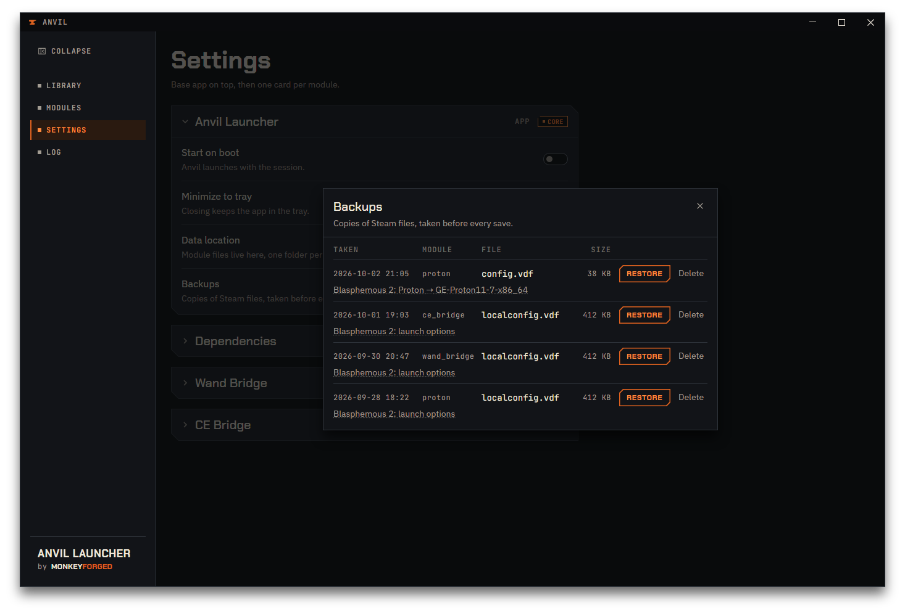
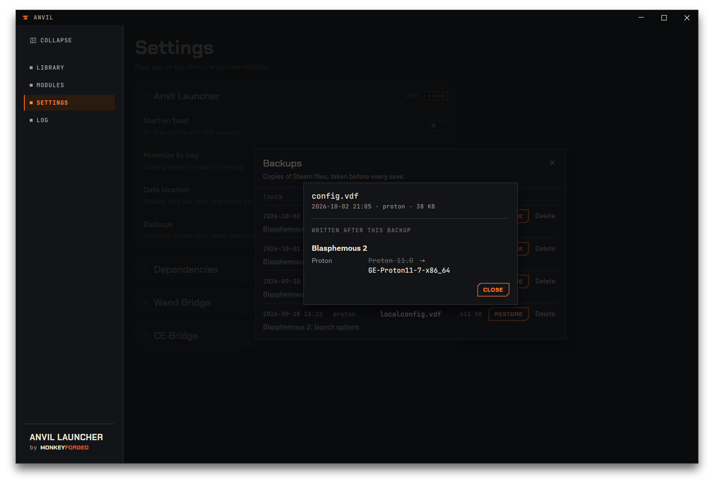

# Backups

Anvil copies a file before it writes to it, every time. This chapter is the reference for
that list: where to find it, what each column means, and what `Restore` and `Delete` do.
The save loop that creates these backups in the first place — and a first look at this same
list — is walked through in
[Your first change](03-first-change.md#4-check-what-happened); this chapter does not repeat
that walkthrough.

## What gets backed up

Anvil backs up **every file it writes to, before it writes to it** — never after, and never
a file it only reads. In version 1.3.1 that means two of Steam's own configuration files,
`config.vdf` and `localconfig.vdf`. Three modules write into them: Proton & launch options for
the fields you edit by hand, Wand Bridge and CE Bridge for the launch option each needs Steam
to carry — see [What it needs first](06-wand-bridge.md#what-it-needs-first).

If a change would leave a file exactly as it already is, nothing is written and no backup is
taken — a save that changes nothing leaves no trace, as covered in
[Your first change](03-first-change.md#3-save--restart).

The copies themselves live at a fixed location, `~/.local/state/anvil/backups`, next to
Anvil's log — see [First run](02-first-run.md#where-anvil-keeps-its-own-files).

## Reading the list

The list is not a page of its own. Open `Settings`, find the `Backups` row in the
`Anvil Launcher` card, and press `Manage`. The list opens over the Settings page; the cross in
its top corner, or a click beside the list, closes it again.

Each entry is one copied file, newest first, in four columns: `TAKEN` (date and time),
`MODULE` (whoever asked for the write), `FILE` (the Steam file that was copied), and `SIZE`.

`MODULE` has six possible values:

| Value | Meaning |
|---|---|
| `proton` | a Proton or launch-options change you made by hand |
| `wand_bridge` | the launch option Wand Bridge sets when you enable it for a game |
| `ce_bridge` | the launch option CE Bridge sets when you enable it for a game |
| `mixed` | more than one module wrote into this file in the same save |
| `launcher` | a copy Anvil made of the current file while restoring an older one |
| `—` | a backup that carries no note at all |

Under most rows sits a short second line saying what the backup was taken for.

Where that line has a dotted underline, click it: a popup opens headed
`WRITTEN AFTER THIS BACKUP`, listing every field that has changed since, grouped by game,
with the old value struck through next to the new one — `empty` stands in for a value that
was not set at all. `Close` shuts the popup and leaves the list open behind it. A second
line without the dotted underline is a note with nothing further behind it to show, and some
rows have no second line at all.

If nothing has ever been written to Steam on your machine, the list says `No backups yet`.

## Restoring a backup

Press `Restore` on the entry you want back. Anvil asks first, in a small window of its own,
naming the file and the time the backup was taken, and warns that Steam will restart and that
everything Steam saved to that file since then will be lost. `Keep current` backs out and
changes nothing, and so do the window's close cross and `Escape`; `Restore`, filled orange,
goes ahead.

A restore runs through the same Save & Restart as an ordinary change: Steam closes, the file
goes back into place, Steam starts again — see
[Your first change](03-first-change.md#3-save--restart). The same restriction applies:
`Restore` is disabled while a game is running, and the list says so at the top.

Two things worth knowing before you press it:

- **The whole file goes back, not just one setting.** Anything else Steam wrote into that
  file after the backup was taken is replaced along with it — that is exactly what the
  confirmation warns about, and the `WRITTEN AFTER THIS BACKUP` popup above is how you check
  what that is before you decide.
- **Restoring is backed up too.** Anvil copies the current file before putting the old one in
  its place, and that copy appears in the list under the module `launcher`. A restore can be
  undone the same way as any other change.

## Deleting backups

`Delete` removes a backup right away, without asking — a backup is only a copy, so deleting
one changes nothing about Steam or your games.

Anvil also removes old backups on its own: after each new one is taken, it keeps the 20 most
recent copies of that file name and drops the rest. You do not need to delete anything just
to keep the folder from growing without bound; use `Delete` when you want a specific backup
gone sooner than that.
