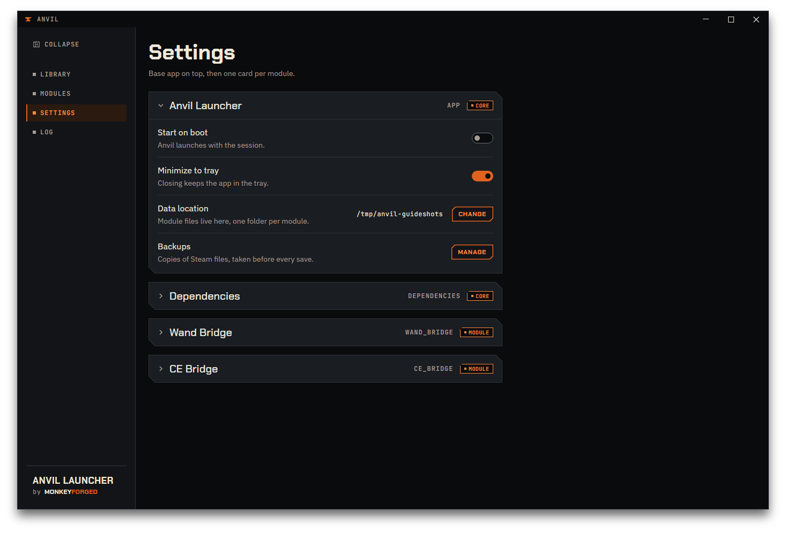
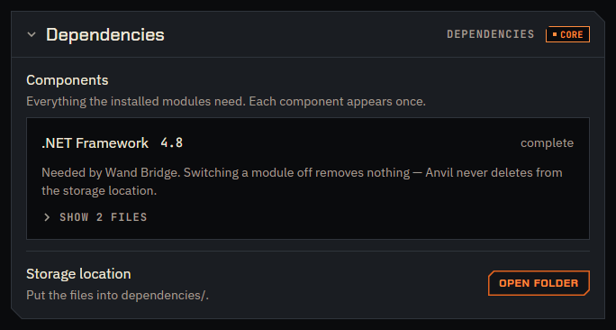
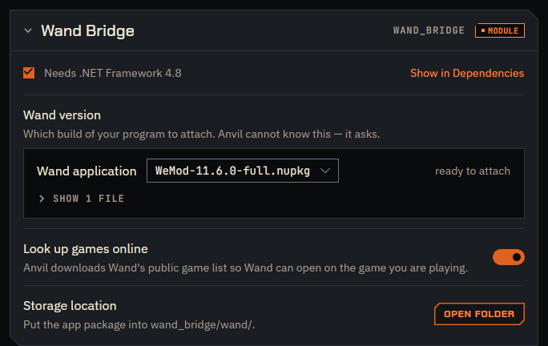
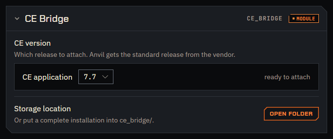

# Settings

Open `Settings` for the app-wide switches: whether Anvil starts with your session, whether
closing its window quits it or keeps it running in the tray, and where modules keep their
files. Backups have their own chapter — see [Backups](08-backups.md).

The page is a stack of cards: `Anvil Launcher` for the app itself on top, then `Dependencies`,
then one card per module. Every card folds — click its header to open or close it. At first only
`Anvil Launcher` is open. The right end of each header shows the card's key and a tag: `Core` for
the parts that belong to Anvil itself, `Module` for a module. A grey tag always means off: `Core`
is always orange, and `Module` is orange while the module is on and grey once you switch it off
on the `Modules` page.

## Start on boot

`Anvil launches with the session.` Turning `Start on boot` on writes an autostart entry for
your desktop session; turning it off removes that entry again. Nothing happens immediately
either way — the app itself does not start or stop, only what happens at your next login
changes.

## Minimize to tray

`Closing keeps the app in the tray.` With `Minimize to tray` on, closing Anvil's window
hides it instead of quitting; the tray icon — see
[First run](02-first-run.md#the-tray-icon) — opens it again.

This only works where a tray is actually available. Anvil detects tray support on its own,
the same way it does for the icon itself, and if it finds none, closing quits the app
regardless of this setting, rather than leaving it running with no way to bring it back.
There is nothing to configure for that check either way.

## Data location

`Data location` is the one folder modules keep their files under, one subfolder per module.
`Change` opens a folder picker and switches to whatever folder you choose.

**Changing it does not move anything.** From that point on Anvil writes new module files to
the folder you picked; whatever was already in the old folder stays exactly where it is —
it is not copied, moved, or deleted. If you want the old files at the new location, move
them yourself first.

This setting also does **not** reach the log, the backups, or Anvil's own settings file:
those live at the fixed locations covered in
[First run](02-first-run.md#where-anvil-keeps-its-own-files), and changing `Data location`
leaves all three exactly where they were.

## Dependencies

Below the `Anvil Launcher` card sits `Dependencies`, tagged `Core`. Some modules need files that are
not Anvil's to ship — installers and runtimes from other people. This card is the one place
those are listed and fetched.

`Components` — `Everything the installed modules need. Each component appears once.` That last
sentence is the point of the card: if more than one module needs the same runtime, it is listed
once and fetched once, not twice. Each row names the component, says which modules need it, and shows
its state:

| State | Meaning |
|---|---|
| `checking` | Anvil is matching what is on disk against size and checksum |
| `complete` | every file this component needs is there |
| `nothing here yet` | none of them are |
| `1 file missing` / `N files missing` | some are there, some are not |
| `no recipe` | Anvil recognises this version but cannot install it |
| `fetching` | a download is running right now |

`Get missing files` downloads exactly what is missing from a row and nothing else. `no recipe`
is the one state that button cannot help with — the note on the row says so, and says what to
do instead: pick a version that has one, or install it yourself.

Switching a module off does not remove anything from this list, and Anvil never deletes from
the storage location on its own. `Storage location` — `Put the files into dependencies/.` —
with `Open folder` to get there, under the `Data location` folder above.

## Wand Bridge

The first bridge module's card, tagged `Module` rather than `Core`, with its key `wand_bridge`
on the right of its header. The card has no on/off switch for the module itself — that is on the
[Modules](10-modules-and-log.md) page. This card holds what the module needs to know:

At the top of the card is a line reading `Needs .NET Framework 4.8`, with `Show in Dependencies`
beside it — a tick in front of it means that component is complete, a yellow square that
something is still missing. The link jumps to the row on
the `Dependencies` card above, so you do not have to go looking for it.

- `Wand version` — `Which build of your program to attach. Anvil cannot know this — it asks.`
  Anvil does not guess which build you want, but it offers one: `Get WeMod 11.6.0` downloads
  that build from the vendor into the folder, checks it against a known checksum and picks it.
  While it runs, the row says `Fetching WeMod-11.6.0-full.nupkg into wand_bridge/wand/.` You can
  also put a package of your own into the folder; this row is where you pick it. The dropdown
  lists the file names it finds there, the vendor build among them once it is fetched. A package that does not contain
  `WeMod.exe` is refused with a message saying so. With a valid one picked, the row reports
  `ready to attach` on its right.
- `Look up games online` — `Anvil downloads Wand's public game list so Wand can open on the game
  you are playing.` On by default, applies at once, no `Save` needed. Off means Anvil never goes
  online for that list: a copy it already has keeps working, and without one Wand opens on its
  home page as before. See
  [Opening Wand on the game](06-wand-bridge.md#opening-wand-on-the-game).
- `Storage location` — `Put the app package into wand_bridge/wand/.`, with `Open folder`.

What the module then does with it is [Wand Bridge](06-wand-bridge.md).

## CE Bridge

The second bridge's card, built like the one above: tagged `Module`, with its key `ce_bridge`
on the right of its header, and no on/off switch for the module itself — that is on the
[Modules](10-modules-and-log.md) page. It has no `Needs` line, because CE Bridge needs nothing
inside the game's prefix, and no `Look up games online` row. What it holds is the Cheat Engine
it attaches:

- `CE version` — `Which release to attach. Anvil gets the standard release from the vendor.`
  A release is a whole Cheat Engine installation, as a folder or a zip. The dropdown lists the
  complete ones it finds in the folder — an incomplete one is left out — and you pick one;
  a release you place yourself is not chosen for you. With one picked, the row reports `ready to attach` on its right.
  Until anything is there it shows an empty note: `Anvil downloads the installer from the
  vendor. You click through it; Anvil keeps the program.`
- `Get CE 7.7`, on the same row, fetches that standard release from its vendor. It asks first —
  see [Confirmations](#confirmations) below — and while it works the row says `fetching`,
  `installer open` and `checking`, with `Cancel` beside it while the installer is open. When
  `bubblewrap` is not installed the button is disabled and a sentence says so. A release it
  fetched successfully is picked for you. All of this,
  including what to answer inside the installer, is
  [Getting Cheat Engine](07-ce-bridge.md#getting-cheat-engine); without the button, see
  [Without bubblewrap](07-ce-bridge.md#without-bubblewrap).
- `Storage location` — `Or put a complete installation into ce_bridge/.`, with `Open folder`.
  That is the way to use a Cheat Engine you already have, or another version:
  [Placing an installation yourself](07-ce-bridge.md#placing-an-installation-yourself).

What the module then does with it is [CE Bridge](07-ce-bridge.md).

## Confirmations

Changing a setting on this page shows no confirmation and no notification — Anvil has no
notifications at all. That is intentional, not missing.

There is one exception: `Get CE 7.7` asks `Open the Cheat Engine installer?` before it does
anything, in a small window of its own. The window that follows is the vendor's installer, not
Anvil, and it offers other software; the question says so and names the answer, `Decline`.
`Cancel` backs out, and so do the question's close cross and `Escape`; `Open installer`, filled
orange, goes ahead. (`Restore` in the backups list asks in the same kind of window — see
[Restoring a backup](08-backups.md#restoring-a-backup).)
