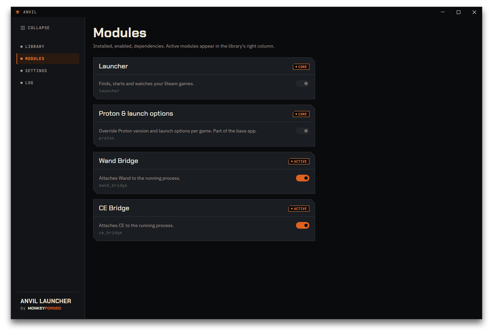
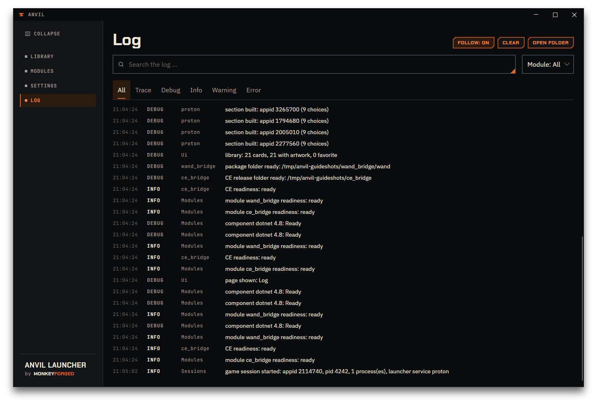

# Modules and the log

## What a module is

A module is a piece of functionality that hooks into Anvil's existing interface — it never
brings its own window, its own settings page, or its own copy of the library. `Modules` lists
every module Anvil knows about, one card per entry: name and a tag in the header, then a short
description, the module's key in small monospaced letters, and a switch. You reach the page from
the navigation, or from `Manage modules` above the module cards in the library's details panel.

Version 1.3.1 ships three modules beyond the base app itself: **Proton & launch options**, the
fields covered in [Proton & launch options](05-proton.md), and two bridges that attach a
second program to a running game — **Wand Bridge**, see [Wand Bridge](06-wand-bridge.md), and
**CE Bridge**, see [CE Bridge](07-ce-bridge.md). The base app's own entry, `Launcher`, sits on
the same page for the same reason — one list, not two kinds of lists. That makes four cards.

## Turning a module off

The switch on a card enables or disables that module everywhere it shows up — for
`Proton & launch options`, that means the `Game` fields in the library's detail panel
disappear when it is off. A card tagged `Core` has no working switch: it stays greyed out,
because that entry belongs to the app itself and cannot be turned off.
The tag itself is orange, like `active`: the app's own entries are always on.

`Launcher` and `Proton & launch options` both carry that tag. `Wand Bridge` and `CE Bridge` do
not — theirs are the two cards on this page whose switch actually does something, and the tag
says how each is doing: `active` when it is on and everything it needs is in place, `not ready`
when something is missing — the reason then stands in yellow under the description — `checking`
while Anvil is still looking, and `off` when you have switched it off.

Switching a bridge off takes its card out of every game's detail panel, its group out of every
context menu, and its chip off every card in the library. The two bridges switch independently:
turning one off leaves the other as it was.

**It does not detach anything that is already attached.** Switching the module off changes what
Anvil shows you, not what is running: a program attached to a game keeps running, and the
button you would use to stop it has just disappeared along with the
card. Switch the module back on and the button is there again, with the attachment still in
place. Detach first, then switch off, if that is the order you meant.

The switch on this page is the global one. Each bridge also has a per-game switch, on its card
in the library's detail panel — off here means off everywhere, regardless of what any
individual game says. See [Turning it on for a game](06-wand-bridge.md#turning-it-on-for-a-game)
for Wand Bridge and [Turning it on for a game](07-ce-bridge.md#turning-it-on-for-a-game) for
CE Bridge.

## The log

`Log` shows what Anvil and its modules do, as it happens: one line per event, newest at the
bottom. Each line has a time, a level (`Trace` through `Error`), a category, and a message.
Warnings stand in yellow, errors in red on a slightly tinted row.
Hover a message that carries more detail — an exception, say — and a tooltip shows it.

`Search the log …` matches against the message and the category as you type. The level tabs
narrow the list to one level or above; the module dropdown narrows it to one category —
`Steam`, `Sessions`, `proton`, `wand_bridge`, `ce_bridge`, and the rest of whatever has logged
something so far, listed as soon as it first appears. A category only shows up once something in
it has logged a line, so `wand_bridge` is absent until the module does something. `ce_bridge` is
usually there from the start: CE Bridge writes a line about whether a release is chosen each
time it checks. `Follow: on` keeps the view scrolled to the newest line; turn it off
to read further up without the list jumping on you.

`Clear` empties the log, both what is on screen and what Anvil is holding in memory — there is
no undo for it. `Open folder` opens the folder that holds the log file on disk, the same
location covered in
[Where Anvil keeps its own files](02-first-run.md#where-anvil-keeps-its-own-files).

## When to look at the log

The log is the place to check when something did not go the way you expected: a change that
does not seem to have taken effect, Steam that did not come back after a save, or a game that
Anvil does not show as running. It is also what to attach when you report a problem — a
description of what happened is useful, the log line that goes with it is what lets someone
else confirm it.

[Troubleshooting](11-troubleshooting.md) walks through the specific cases above, and names the
exact log line that confirms each one.
